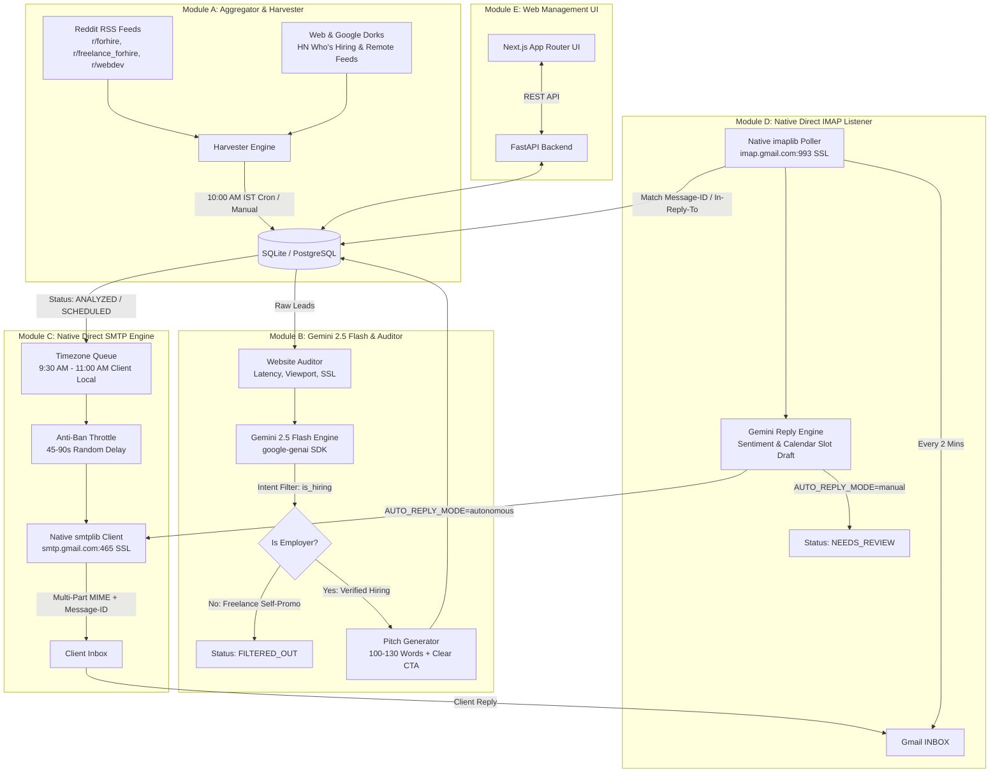

# AutoLead AI 🚀
### Autonomous AI-Powered Lead Generation, Cold Outreach & Follow-up Agent

AutoLead AI is a production-grade, end-to-end autonomous agent that harvests high-intent freelance/contract leads from Reddit, LinkedIn, and the Web, executes real-time technical audits with Google Gemini 2.5 Flash, and manages cold outreach and reply threads using **pure native SMTP and IMAP protocols** with Google App Passwords.

> **CRITICAL ARCHITECTURAL GUARANTEE:**
> AutoLead AI **DOES NOT** use any third-party email APIs (e.g., Resend, SendGrid, Mailgun). All outbound dispatch is handled via native direct SMTP (`smtp.gmail.com:465` SSL / `587` TLS) and all inbound reply parsing is handled via native direct IMAP (`imap.gmail.com:993` SSL) with RFC 2822 `Message-ID` and `In-Reply-To` threading.

---

## 1. System Architecture & Workflow



---

## 2. Core Modules Breakdown

### Module A: Lead Scraping & Aggregator Engine
- **Sources**:
  - Reddit RSS Feeds: `r/forhire`, `r/freelance_forhire`, `r/webdev` filtered for `[Hiring]` and `Looking for` posts.
  - Web & Dork Feeds: Hacker News Who's Hiring and curated remote tech channels.
- **Fields Extracted**:
  - `id`, `source` (Reddit/LinkedIn/Web), `title`, `raw_text`, `author_id`, `email`, `website_url`, `detected_country`, `timezone` (defaults to `US-EST` if outside India), and initial status `RAW`.
- **Deduplication**: Automatically deduplicates by `source_url` and normalized title.
- **Schedule**: APScheduler cron trigger daily at **10:00 AM IST** (`Asia/Kolkata`), plus manual trigger button.

### Module B: Gemini 2.5 Flash Analysis & Personalization Engine
- **SDK**: Official `google-genai` SDK (`from google import genai`).
- **Intent Filter**: Identifies whether the post is a genuine founder/employer looking to hire (`is_hiring: true`) or a freelancer self-promoting (`is_hiring: false` -> `FILTERED_OUT`).
- **Niche & Deliverable Extraction**: Identifies exact deliverables (e.g., Next.js landing page revamp, Shopify conversion lift, Python API pipeline).
- **Website Audit Engine**:
  - If a URL is present: Measures server response time (TTFB ms), checks mobile viewport readiness and SEO metadata, generating 2 actionable critiques.
  - If no URL is present: Outlines 3 commercial benefits tailored directly to the client's industry.
- **Cold Pitch Drafting**:
  - Generates ultra-personalized, authentic, non-salesy **100–130 word email body**.
  - Incorporates relevant portfolio and scheduling links with a low-friction CTA.

### Module C: Direct SMTP Outbound Engine (App Password)
- **Protocol**: Direct standard library `smtplib` connection to `smtp.gmail.com` on Port 465 (SSL) or Port 587 (TLS).
- **MIME Composition**: RFC 2822 compliant multi-part MIME (`text/plain` and styled `text/html`) with custom `Message-ID`, `Date`, `In-Reply-To`, and `References` headers.
- **Timezone-Aware Queue**: Evaluates recipient's local timezone and dispatches within peak engagement hours (**9:30 AM to 11:00 AM** recipient local time).
- **Anti-Ban Throttling**: Injects a random **45–90 second delay** between consecutive bulk emails to avoid Gmail rate limits.
- **Action Center Override**: 1-Click "Send Now" button directly dispatches without waiting for queue.

### Module D: Native IMAP Reply Listener & Auto-Reply Agent
- **Protocol**: Direct standard library `imaplib` connection to `imap.gmail.com:993` (SSL).
- **Poller**: Background worker polls `INBOX` every 2 minutes for `UNSEEN` emails.
- **Thread Matching**: Matches incoming emails by RFC 2822 `In-Reply-To` / `References` matching lead's `message_id`, or by sender email.
- **Sentiment Classification**: Categorizes replies into `INTERESTED`, `SCHEDULING`, `NOT_INTERESTED`, `OBJECTION`, or `NEUTRAL`.
- **Autonomous vs. Manual Mode**:
  - `manual`: Drafts a follow-up response with calendar links and flags thread as `NEEDS_REVIEW`.
  - `autonomous`: Automatically dispatches the drafted response via SMTP to interested leads.

### Module E: Modern Web Tracking Dashboard (Next.js)
- **Overview Analytics**:
  - Total Scraped Today, Valid Leads, Emails Dispatched via Direct SMTP, Reply Rate %.
  - Live Pipeline breakdown across all 6 stages.
  - Channel distribution (Reddit, LinkedIn, Web) and live operational event stream.
- **Live Leads Pipeline**:
  - Interactive **Kanban Board** with columns: `RAW`, `ANALYZED`, `SCHEDULED`, `SENT`, `REPLIED`, `FILTERED_OUT`.
  - Alternative **Data Table View** with sorting, search, and instant action triggers.
- **1-Click Approve Action Center**:
  - Focus review mode for reviewing Gemini-drafted pitches before SMTP delivery.
  - Editable subject line, recipient email, and email body.
  - 1-Click "Send Now via SMTP", "Queue for Timezone", or "Discard".
- **Settings & Diagnostics**:
  - Input/update Gemini API Key and Gmail credentials (`EMAIL_USER`, `EMAIL_APP_PASSWORD`).
  - Interactive **"Test Direct SMTP Connection"** button (instant feedback).
  - Interactive **"Test Direct IMAP Connection"** button (instant feedback).

---

## 3. Tech Stack

| Layer | Technology |
|---|---|
| **Backend** | Python 3.14, FastAPI, Uvicorn |
| **Frontend** | Next.js 16 (App Router), React 19, Tailwind CSS v4, Lucide React |
| **AI Personalization** | Google Gemini 2.5 Flash via official `google-genai` SDK |
| **Database** | SQLite / SQLAlchemy ORM (compatible with PostgreSQL) |
| **Task Scheduler** | APScheduler (AsyncIOScheduler) |
| **Outbound Email** | Native Python `smtplib` + `email.mime` (Google App Password) |
| **Inbound Email** | Native Python `imaplib` + `email` (Gmail IMAP Port 993 SSL) |

---

## 4. Project Directory Structure

```
autolead-ai/
├── .env.example                  # Environment configuration template
├── README.md                     # Comprehensive documentation
├── backend/
│   ├── requirements.txt          # Python dependencies
│   └── app/
│       ├── __init__.py
│       ├── config.py             # Settings & runtime DB overrides
│       ├── database.py           # SQLAlchemy SQLite connection
│       ├── models.py             # Lead, EmailThread, AppSetting, SystemLog
│       ├── schemas.py            # Pydantic request/response schemas
│       ├── main.py               # FastAPI app, lifespan, CORS & routers
│       ├── services/
│       │   ├── scraper.py        # Reddit RSS, Dorks & Web harvester
│       │   ├── website_auditor.py# TTFB latency, SSL, mobile viewport check
│       │   ├── gemini_engine.py  # google-genai 2.5 Flash pitch & reply agent
│       │   ├── smtp_engine.py    # Native smtplib, MIME builder, anti-ban throttle
│       │   ├── imap_engine.py    # Native imaplib INBOX listener & thread matcher
│       │   └── scheduler.py      # APScheduler 10:00 AM IST & interval workers
│       └── api/
│           ├── leads.py          # CRUD, single/bulk analyze, send-now, schedule
│           ├── analytics.py      # Real-time pipeline metrics & reply rate
│           ├── settings.py       # Configuration & SMTP/IMAP connection tests
│           └── system.py         # Manual trigger harvester & IMAP poll
└── frontend/
    ├── package.json
    ├── next.config.ts
    ├── tsconfig.json
    └── src/
        ├── types/index.ts        # TypeScript data contracts
        ├── lib/api.ts            # Typed REST API client
        ├── app/
        │   ├── layout.tsx        # Root layout with dark mode
        │   ├── page.tsx          # Main Dashboard orchestration
        │   └── globals.css       # Tailwind CSS styling
        └── components/
            ├── Header.tsx            # Navigation, quick harvest & IMAP buttons
            ├── AnalyticsOverview.tsx # KPI cards, pipeline stages, activity feed
            ├── ActionCenter.tsx      # 1-Click Approve cold pitch review
            ├── LeadsPipeline.tsx     # Switchable Kanban board & Data table
            ├── LeadDetailModal.tsx   # Deep inspection, audit, thread history & reply box
            ├── InboxThreads.tsx      # Reply listener view with sentiment tags
            └── SettingsModal.tsx     # Credentials & live diagnostic test buttons
```

---

## 5. Quickstart & Installation

### Step 1: Clone and Set Up Environment Variables

```bash
cd autolead-ai
cp .env.example .env
```

Edit `.env` (or configure directly in the Web Dashboard Settings):
```env
# Google Gemini API
GEMINI_API_KEY=your_gemini_key

# Native Gmail Direct SMTP (Outbound) & IMAP (Inbound) Engine
EMAIL_USER=your_email@gmail.com
EMAIL_APP_PASSWORD=your_16_char_google_app_password
SMTP_HOST=smtp.gmail.com
SMTP_PORT=465
IMAP_HOST=imap.gmail.com
IMAP_PORT=993
SENDER_NAME=Alex Rivera

# Outbound Pitch Persona Links
PORTFOLIO_URL=https://alexrivera.dev
CALENDLY_URL=https://calendly.com/alexrivera/30min

# Database
DATABASE_URL=sqlite:///./autolead.db

# Inbound Auto-Reply Mode: 'manual' or 'autonomous'
AUTO_REPLY_MODE=manual
```

> **Tip for Google App Password**:
> Go to [Google App Passwords](https://myaccount.google.com/apppasswords), generate a 16-character password for "Mail", and paste it into `EMAIL_APP_PASSWORD`.

---

### Step 2: Start the Backend (FastAPI)

```bash
# Create and activate virtual environment
python3 -m venv backend/venv
source backend/venv/bin/activate

# Install dependencies
pip install -r backend/requirements.txt

# Run FastAPI server
uvicorn main:app --reload --port 8000

# Kill the running port
kill -9 $(lsof -t -i:8000)
```

The backend starts at `http://127.0.0.1:8000` with Swagger docs at `http://127.0.0.1:8000/docs`.

---

### Step 3: Start the Frontend (Next.js)

In a new terminal:
```bash
cd frontend
npm install
npm run dev
```

Open your browser at `http://localhost:3000`.

---

## 6. API Reference

| Method | Endpoint | Description |
|---|---|---|
| `GET` | `/api/analytics` | Overview metrics, status counts, source distribution, and logs |
| `GET` | `/api/leads` | List leads with filtering (`status`, `source`, `country`, `search`) |
| `GET` | `/api/leads/{id}` | Retrieve single lead with complete email thread history |
| `POST` | `/api/leads/{id}/analyze` | Trigger Gemini 2.5 Flash technical audit & pitch synthesis |
| `POST` | `/api/leads/analyze-all-raw` | Bulk analyze all pending RAW leads |
| `POST` | `/api/leads/{id}/send-now` | **1-Click Approve**: Dispatches pitch via native SMTP |
| `POST` | `/api/leads/{id}/schedule` | Queue lead for 9:30 AM - 11:00 AM delivery in recipient timezone |
| `POST` | `/api/leads/{id}/discard` | Discard lead (marks as `FILTERED_OUT`) |
| `POST` | `/api/leads/{id}/reply` | Send follow-up or reply to client thread via SMTP |
| `GET` | `/api/settings` | Retrieve runtime system settings |
| `POST` | `/api/settings` | Update settings and persona links |
| `POST` | `/api/settings/test-smtp` | Diagnostic: Test direct SMTP SSL/TLS connection |
| `POST` | `/api/settings/test-imap` | Diagnostic: Test direct IMAP SSL connection |
| `POST` | `/api/system/harvest-now` | Trigger harvester across Reddit RSS and web feeds |
| `POST` | `/api/system/poll-imap-now` | Trigger IMAP check to parse incoming replies |
| `POST` | `/api/system/seed-demo` | Seed high-intent sample leads across all sources |

---

## 7. Verification & Testing

1. **Verify Backend Status**:
   ```bash
   curl -s http://127.0.0.1:8000/
   ```
2. **Verify Scraped Leads**:
   ```bash
   curl -s http://127.0.0.1:8000/api/leads | jq .[0]
   ```
3. **Verify Pipeline Analytics**:
   ```bash
   curl -s http://127.0.0.1:8000/api/analytics | jq .
   ```
4. **Test SMTP / IMAP Connection**:
   In the Dashboard, click the **Settings** icon (top right) and click **"Test SMTP Connection"** and **"Test IMAP Connection"**.

